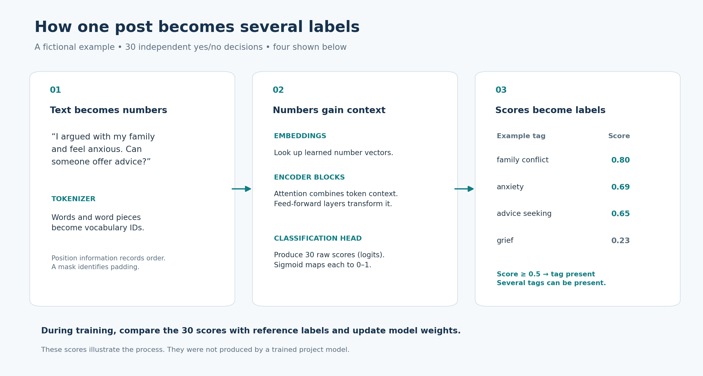
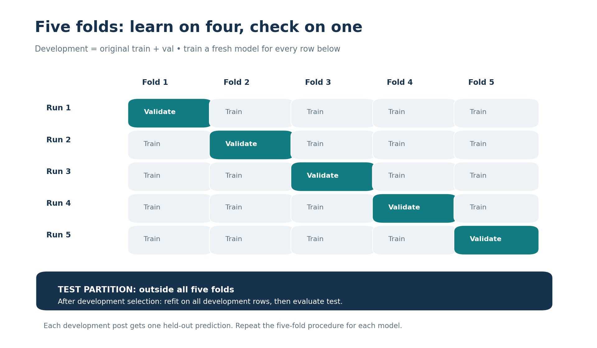

# BERT classification, from the beginning

## 1. Start with one post

Imagine this fictional example:

> I argued with my family and feel anxious. Can someone offer advice?

We want the computer to recognize several kinds of information:

| Family of labels | Possible example tag | Why it might fit |
| --- | --- | --- |
| Stressors | `family conflict` | The post describes an argument |
| Relationships | `family` | The argument involves family |
| Emotions | `anxiety` | The author describes feeling anxious |
| Responses | `advice seeking` | The author asks for advice |

This is a teaching example, not a newly annotated data record. The real
codebook determines the final annotation decisions.

A **label** is one possible answer, such as `anxiety`. A **label family**
groups related answers, such as emotions. A **reference annotation** is the
answer in the dataset that we use for learning and evaluation. Reference
annotations can contain mistakes, so their quality affects the experiment.

## 2. Turn the answers into a target vector

The helper has a fixed list of 30 labels. For every post it creates 30
positions. A position is `1` if its tag is present and `0` otherwise.

| A small slice of the 30 positions | family conflict | family | anxiety | advice seeking | grief |
| --- | --- | --- | --- | --- | --- |
| Teaching example | 1 | 1 | 1 | 1 | 0 |

Several positions can be 1 together. This is a **multi-hot vector** and a
**multilabel problem**. During training the model receives text as input
and this vector as the expected output. During prediction, it receives
text and produces its own 30 scores.

## 3. Turn text into model inputs

A tokenizer breaks text into tokens, which can be whole words, word pieces,
or punctuation. It then looks up an integer ID for each token.
Token IDs are vocabulary addresses: a larger ID does not mean a stronger
emotion. The actual tokens depend on the selected model's tokenizer.

An **embedding** changes a token ID into a learned vector of numbers.
Position information gives the encoder information about token order.
An attention mask identifies actual tokens versus padding, so padding can
be excluded from attention. Position information and padding masks do
different jobs.

Longer posts are cut at `MAX_LENGTH=512` total tokens, including special
tokens. This can discard useful information. The notebook records how many
development posts exceed that limit; those counts are not model accuracy.

## 4. Let the encoder build context

Consider “I am happy” and “I am not happy.” A useful representation must
account for the nearby word “not,” rather than treating “happy” by itself.
Self-attention lets a token's representation combine information from other
tokens in the same post. Different attention heads can learn different
relationships; no head is guaranteed to represent a particular concept.

Each encoder block applies attention and a small feed-forward network,
together with residual connections and normalization. Repeating the blocks
produces richer contextual token representations. These operations are
numerical calculations with learned weights, not hand-written keyword rules.

The pretrained encoder already has language representations learned from
earlier training. **Fine-tuning** adjusts its weights, together with the
classification head, for this project's labels. The pretrained model does
not automatically know the dataset's annotation codebook.

### A closer look at one attention calculation

Each token vector is projected into three learned vectors: a **query (Q)**,
a **key (K)**, and a **value (V)**. For a particular query token, compare its
query with the keys of the available tokens. A scaled dot product produces
a compatibility score for each token. Softmax converts those scores to
attention weights, and the output is a weighted sum of the value vectors.

For a tiny fictional calculation, suppose the two compatibility scores are
2 and 1. Their softmax weights are about 0.731 and 0.269. If the corresponding
value vectors are `[2, 0]` and `[0, 2]`, the combined vector is approximately
`[1.462, 0.538]`. This is a numerical example of combining information;
these are not extracted model weights or an explanation of a real decision.

Multiple attention heads perform related calculations in different learned
spaces. The resulting information is combined before the following
transformations. An attention block can use **softmax over token positions**
even though our final classifier uses **sigmoid over independent tags**.
Those operations answer different questions and do not conflict.

## 5. Produce one score per label

The classification head converts encoder output into 30 raw numbers called
**logits**. A logit can be negative, zero, or positive. Apply sigmoid to each
logit separately to obtain a score between 0 and 1:

$$p = \frac{1}{1 + e^{-z}}$$

Here, $z$ is one label's logit. The fixed rule in this notebook is:
predict a label when its sigmoid score is at least **0.5**.

| Example label | Illustrative logit | Sigmoid score, rounded | Prediction |
| --- | --- | --- | --- |
| anxiety | 1.4 | 0.802 | present |
| advice seeking | 0.8 | 0.690 | present |
| grief | -1.2 | 0.231 | absent |

The scores do not have to sum to 1. Each label has its own yes/no decision.
Softmax would instead make these 30 tags compete for a fixed total,
which does not match the independent decisions used in this experiment.
A sigmoid score of 0.8 is not a verified claim of 80% reliability;
calibration would need its own evaluation.

## 6. Learn by measuring mistakes

The **loss function** measures how far the prediction is from the reference
answer. This notebook uses binary cross-entropy with logits, applied across
all 30 tags. For a positive label, predicting 0.2 is penalized more than
predicting 0.8. For an absent label, a high score is penalized instead.

Backpropagation calculates gradients: how the loss changes when the model's
weights change. AdamW uses those gradients to update the weights. The
learning rate controls the scale of each update. A training step therefore
follows this order: calculate predictions, calculate loss, calculate
gradients, and update weights when the accumulation group is complete.

| Setting | Meaning in this notebook |
| --- | --- |
| Batch size = 4 | Process up to four posts in one mini-batch |
| Gradient accumulation = 4 | Combine gradients from four mini-batches before an update; about 16 posts per full update |
| Epochs = 10 | Make ten passes through that fit's training partition |
| Learning rate = 0.00002 | Scale used for weight updates |
| Weight decay = 0.01 | Regularize selected weights; biases and LayerNorm weights are excluded |
| Class weights enabled | Adjust the positive-label loss using counts from the current training partition |
| Gradient clipping = 1.0 | Limit the gradient norm before an update |

Accumulation approximates a larger batch for gradient updates; the final
partial group can contain fewer posts. Class weights are clipped between
0.1 and 10. If a training partition has no positive or no negative examples
for a tag, its weight defaults to 1. Class weighting cannot teach a positive
category that has no positive training examples.

## 7. Ask whether learning transfers to unseen posts

A model can perform well on examples it trained on and poorly on new ones.
We therefore separate learning from evaluation.

The original `train` and `val` rows become the development set. Divide that
development set into five folds. For each run, train a new copy of the model
on four folds and evaluate on the remaining fold. Rotate the held-out fold
until every development post has one prediction from a model that did not
train on it. These are **out-of-fold predictions**.

The splitter tries to balance the 30 tags plus TBe/PBu-group indicators.
Rare labels may still be absent from individual folds. Balancing those
metadata values does not give them to the classifier as input features.

Mean development macro F1 selects the model. Then each predeclared model is
trained fresh on all development rows and evaluated on the test partition.
Do not change settings because a test score looks disappointing and then
describe that same test partition as untouched.

The current implementation has no inner hyperparameter-search loop. Its
five-fold evaluation should be described as ordinary cross-validation.

## 8. Understand what a score means

Take one label, `anxiety`. Suppose there are 10 reference-positive posts.
The model predicts anxiety for 8 posts, and 6 of those predictions are
correct. Then TP = 6, FP = 2, and FN = 4.

| Metric | Calculation | Interpretation |
| --- | --- | --- |
| Precision | 6 / (6 + 2) = 0.75 | Of predicted anxiety tags, 75% were correct |
| Recall | 6 / (6 + 4) = 0.60 | Of reference anxiety tags, 60% were recovered |
| F1 | 2 × 6 / (2 × 6 + 2 + 4) = 0.667 | Balances precision and recall |

**Macro F1** calculates F1 for each tag and then averages those tag scores.
**Micro F1** pools the TP/FP/FN counts across tags before calculating F1.
**Exact-match accuracy** gives credit to a post only if its entire set of
30 decisions is correct. **Hamming loss** counts the fraction of wrong
post–label decisions; lower is better.

A development bar chart's error bars show the **standard deviation across
folds**. They describe fold-to-fold variation, not a confidence interval.
[The results guide](RESULTS_GUIDE.md) explains additional metrics and the
helper's handling of empty or unsupported labels.

## 9. Understand the three model names

All three models below use the same 30-label task, data preparation,
fold assignments, and evaluation procedure. Their tokenizers and pretrained
encoders differ. The experiment must determine which works best here.

| Model | Beginner explanation | Exact identifier in the supplied code |
| --- | --- | --- |
| BERT | A pretrained encoder that builds representations using context from both directions | `google-bert/bert-base-uncased` |
| RoBERTa | A BERT-style encoder with a revised pretraining recipe | `FacebookAI/roberta-base` |
| DistilBERT | A smaller encoder trained using knowledge distillation | `distilbert/distilbert-base-uncased` |

## Primary references

- [BERT paper](https://arxiv.org/abs/1810.04805)
- [RoBERTa paper](https://arxiv.org/abs/1907.11692)
- [DistilBERT paper](https://arxiv.org/abs/1910.01108)
- [Hugging Face BERT implementation](https://huggingface.co/docs/transformers/model_doc/bert)
- [scikit-learn F1 definition and averaging](https://scikit-learn.org/stable/modules/generated/sklearn.metrics.f1_score.html)
- [scikit-learn classification metrics](https://scikit-learn.org/stable/modules/model_evaluation.html)
